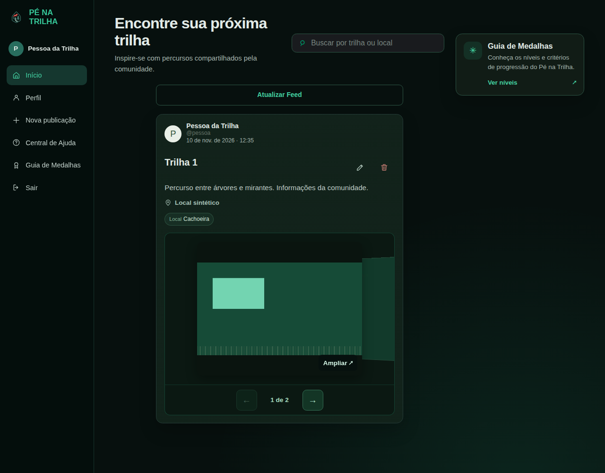
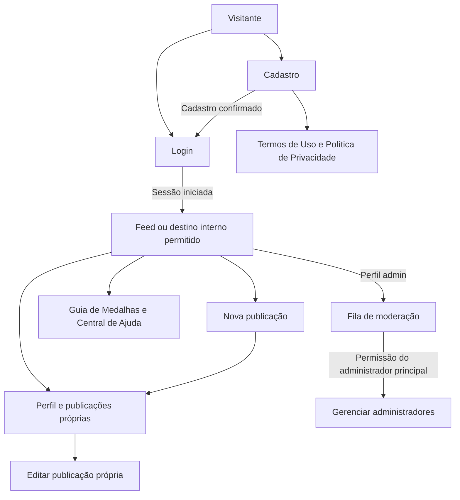

# Pé na Trilha · Frontend

[](pe-na-trilha/package-lock.json)
[](pe-na-trilha/package-lock.json)
[](.github/workflows/ci.yml)

Aplicação web acadêmica para **encontrar e compartilhar trilhas, praias e cachoeiras**. Ela reúne relatos, características do local e fotos em um feed pesquisável, ajudando pessoas que praticam atividades ao ar livre a comparar percursos antes de uma visita. Quem contribui acompanha no próprio perfil a análise das publicações e a evolução das medalhas.

**Repositórios** · Frontend (este repositório) · [Backend e referência da API](https://github.com/DaviLLi/pe-na-trilha-backend)

[Interface](#interface-e-funcionalidades) · [Navegação](#navegação) · [Execução local](#execução-local) · [Testes e publicação](#testes-build-e-publicação)

<details>
<summary>Visualizar o feed e a busca</summary>



Captura do repositório com dados sintéticos, registrada durante a validação do layout. [Capturas em celular](docs/validacao-quatro-ajustes)

</details>

## Interface e funcionalidades

| Área | Comportamento implementado |
| --- | --- |
| Conta e sessão | Cadastro com aceite dos Termos de Uso e ciência da Política de Privacidade, login por e-mail ou nome de usuário, restauração da sessão e saída. O login exibe um contador após receber `429`. |
| Feed | Publicações aprovadas com busca por título, descrição, local e características. Os cartões apresentam o autor, os detalhes do percurso e uma galeria quando há fotos disponíveis. |
| Nova publicação | Formulário com título, descrição e localização obrigatórios, perguntas e duração opcionais, prévia de até cinco fotos e confirmação individual de cada upload. |
| Perfil | Edição de nome, nome de usuário e e-mail, com recorte, substituição e remoção do avatar. A seção de contribuições exibe o status, o motivo de rejeição quando informado e as ações disponíveis para o autor. |
| Medalhas | Guia e galeria de cinco níveis no perfil. A progressão é calculada no frontend a partir das publicações próprias aprovadas retornadas pela API. |
| Moderação | Administradores consultam a fila de pendências, aprovam ou rejeitam com motivo. O administrador principal pode listar, promover e remover outros administradores, com confirmação de senha nas alterações. |

A Central de Ajuda existe e ainda contém orientações antigas sobre fotos, moderação e edição de perfil. Os textos de Termos de Uso e Política de Privacidade estão disponíveis para o fluxo de cadastro e ainda têm campos editoriais a preencher. [Central de Ajuda](pe-na-trilha/src/pages/Ajuda.jsx) · [Pendências dos documentos legais](docs/pendencias-documentos-legais.md)

## Navegação

| Rotas | Acesso e função |
| --- | --- |
| `/login` e `/cadastro` | Visitantes. O cadastro confirmado encaminha para o login. |
| `/termos` e `/privacidade` | Acesso público aos documentos versionados. |
| `/` e `/trilhas` | Usuários autenticados. A raiz redireciona para o feed. |
| `/trilhas/nova` e `/trilhas/:id/editar` | Criação e edição de publicações. A API verifica autoria e status na edição. |
| `/perfil`, `/medalhas` e `/ajuda` | Usuários autenticados. Conta e contribuições, guia de níveis e Central de Ajuda. |
| `/admin` e `/admin/administradores` | Moderação para administradores. O gerenciamento de administradores exige autorização adicional da API para o administrador principal. |



O roteador mantém a tela de carregamento enquanto restaura a sessão. Se a verificação estiver temporariamente indisponível, a tela oferece uma nova tentativa. Sem sessão, uma rota protegida leva ao login e guarda o destino interno permitido. No feed, a interface distingue carregamento, erro de rede, lista vazia e busca sem resultados. [Rotas e proteção de acesso](pe-na-trilha/src/App.jsx) · [Feed](pe-na-trilha/src/pages/ListaTrilhas.jsx)

### Da publicação ao feed

1. A interface envia os dados da publicação à API. Quando há fotos selecionadas, o cadastro informa quantas são esperadas e recebe a publicação com status pendente.
2. Cada foto é enviada em uma requisição própria. Se um envio falhar, as fotos confirmadas são preservadas. O autor pode completar os envios pela edição no Perfil. Se a criação ficar sem confirmação, o recibo orienta a conferir o Perfil antes de repetir o cadastro.
3. A fila administrativa recebe publicações pendentes com os envios previstos concluídos. Uma aprovação inclui a publicação no feed e na contagem de medalhas. Uma rejeição exibe o motivo ao autor, que pode corrigir e reenviar pelo Perfil.
4. Em publicações aprovadas, o autor pode alterar características e duração ou excluir a publicação. A edição de título, descrição, localização e fotos fica disponível enquanto a publicação estiver pendente ou rejeitada.

## Tecnologias e organização

| Tecnologia | Uso |
| --- | --- |
| React e React DOM `19.2.5`, React Router DOM `7.18.6` | SPA com `BrowserRouter`, rotas protegidas e contexto de sessão. |
| Vite `8.3.8`, plugin React `6.0.1` | Servidor local e build estático. |
| Axios `1.21.1` | Cliente HTTP da API REST com cookies, renovação da sessão e cabeçalho CSRF. |
| CSS, Manrope e Sora | Interface responsiva em CSS. As fontes são carregadas do Google Fonts. |
| ESLint `9.39.4`, `node:test` e Chrome | Análise estática, testes de lógica e testes de interface com API simulada. |

As versões da tabela correspondem ao [lockfile da aplicação](pe-na-trilha/package-lock.json).

| Caminho em `pe-na-trilha/` | Responsabilidade |
| --- | --- |
| `src/main.jsx` e `src/App.jsx` | Montagem da SPA, roteamento, layout e controle de acesso à navegação. |
| `src/pages/` e `src/components/` | Páginas, menu, formulários, cartões, galerias e editor de avatar. |
| `src/contexts/` | Sessão, acesso ao gerenciamento de administradores e carregamento de imagens de publicações. |
| `src/services/` e `src/data/` | Cliente da API, fluxos de envio, validações, cache de imagens e dados dos formulários, medalhas e documentos. |
| `src/styles/`, `src/assets/` e `tests/` | Estilos, mídia local e testes. |

`api.js` envia requisições com `withCredentials` e mantém o token CSRF em memória. Os cookies de sessão são definidos pela API. Em um `401` elegível, o cliente tenta renovar a sessão antes de repetir a requisição. Se a validação de CSRF falhar, a interface pede uma nova confirmação do usuário após recuperar a verificação. O feed e a edição solicitam metadados e conteúdo de fotos de publicações pela API. Os avatares são exibidos por URL pública do Cloudinary. [Cliente HTTP](pe-na-trilha/src/services/api.js) · [API e arquitetura](https://github.com/DaviLLi/pe-na-trilha-backend)

## Execução local

Use **Node.js 22 LTS** (22.12 ou superior na série 22 para o Vite), npm e um checkout compatível do backend. Siga a configuração de homologação do backend antes de testar cadastro, login e publicações. [Configuração do backend](https://github.com/DaviLLi/pe-na-trilha-backend)

Na raiz deste repositório, instale pelo lockfile da aplicação e inicie o Vite.

```bash
cd pe-na-trilha
npm ci
npm run dev:homologation
```

Em outro terminal, execute `npm run dev:homologation` **na raiz do backend**. No navegador, abra `http://127.0.0.1:5174`.

| Ambiente | Comando nos dois repositórios | Frontend | API |
| --- | --- | --- | --- |
| Homologação | `npm run dev:homologation` | `http://127.0.0.1:5174` | `http://127.0.0.1:3001` |
| Produção executada localmente | `npm run dev:production` | `http://localhost:5173` | `http://localhost:3000` |

Os scripts locais do Vite fixam a origem da API de cada ambiente. Use os hosts da tabela exatamente como escritos para respeitar o CORS e o escopo dos cookies. O modo local de produção usa os recursos de produção configurados no backend.

## Testes, build e publicação

Execute os comandos em `pe-na-trilha/`.

| Comando | Resultado |
| --- | --- |
| `npm run lint` | Verifica o código com ESLint. |
| `npm test` | Executa a suíte `node:test`, incluindo cenários de navegador quando o Chrome está disponível. |
| `npm run test:auth` | Executa os arquivos de testes do serviço e da validação de autenticação. |
| `npm run build` | Gera `dist/` com a origem HTTPS da API de produção. |
| `npm run build:homologation` | Gera `dist/` com a API local de homologação em `http://127.0.0.1:3001`. |
| `npm run preview` | Serve o último build localmente e mantém a origem da API gravada no bundle. |

Os testes de navegador usam Chrome em modo headless e uma API simulada. Configure `PNT_CHROME_BIN` se o executável estiver fora de `/usr/bin/google-chrome`. A CI exige o Chrome e roda `node --test --test-concurrency=1 tests/*.test.js`. [Script de teste](pe-na-trilha/package.json) · [Workflow de CI](.github/workflows/ci.yml)

### Build de produção e hospedagem

A publicação documentada usa **Vercel** para o bundle estático e **Render** para a API. Na Vercel, configure a raiz `pe-na-trilha`, instalação com `npm ci`, build com `npm run build` e saída `dist`. O `vercel.json` encaminha acessos diretos como `/perfil` e `/admin` ao HTML da SPA. A hospedagem estática permite distribuir a interface separadamente do processo da API e do banco. [Configuração da SPA](pe-na-trilha/vercel.json) · [Guia de publicação](docs/ci-cd.md)

- Defina `VITE_API_URL` no ambiente de build da Vercel ou em `pe-na-trilha/.env.production` para build local. O valor deve ser uma origem HTTPS em domínio não local, sem caminho, credenciais, query ou fragmento. O valor entra no bundle público. [Modelo de configuração](pe-na-trilha/.env.production.example)
- Configure `FRONTEND_ORIGINS` no backend com a origem exata do site. Verifique a sessão por cookies e o CSRF nos domínios definitivos e nos navegadores que serão usados.
- O histórico registra branches de trabalho integradas por pull requests em `develop` e integração de `develop` em `main`. O GitHub Actions valida pushes e PRs nessas duas branches com ESLint, testes e os dois builds. A configuração de publicação, a branch vinculada aos provedores, os domínios ativos e a automação de deploy dependem dos painéis dos provedores e carecem de confirmação. [Workflow de CI](.github/workflows/ci.yml) · [Histórico de pull requests](https://github.com/DaviLLi/pe-na-trilha-frontend/pulls?q=is%3Apr+is%3Amerged)

### Problemas frequentes

| Sintoma | O que conferir |
| --- | --- |
| Falha de CORS ou sessão que volta ao login | Se os dois terminais estão no mesmo ambiente e os hosts correspondem aos da tabela. Em hospedagem, confira a origem autorizada, HTTPS e a política de cookies do navegador. |
| Login recebe `429` | Aguarde a contagem do formulário. O cliente lê `Retry-After` quando o cabeçalho está disponível. |
| Build de produção recusa `VITE_API_URL` | Informe somente a origem HTTPS da API em um domínio válido. Para gerar um bundle para a API local, use `npm run build:homologation`. |
| `preview` abre a interface, mas o login falha | O servidor de preview tem origem própria e o bundle mantém a API do build. Para testar login com o par de origens já configurado, use `npm run dev:homologation`. |
| Publicação pendente ausente da fila administrativa | Confira no Perfil se todas as fotos previstas foram confirmadas e complete o envio se necessário. |

Projeto desenvolvido por **Davi Martinelli Landal**.
